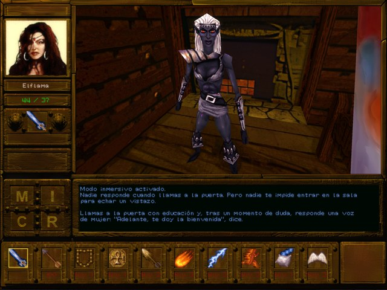
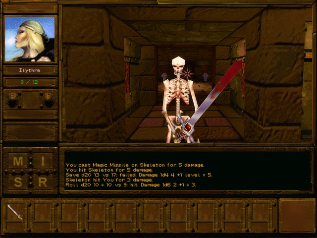
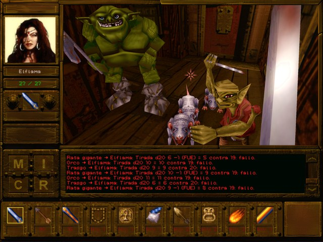
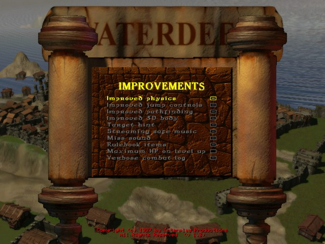
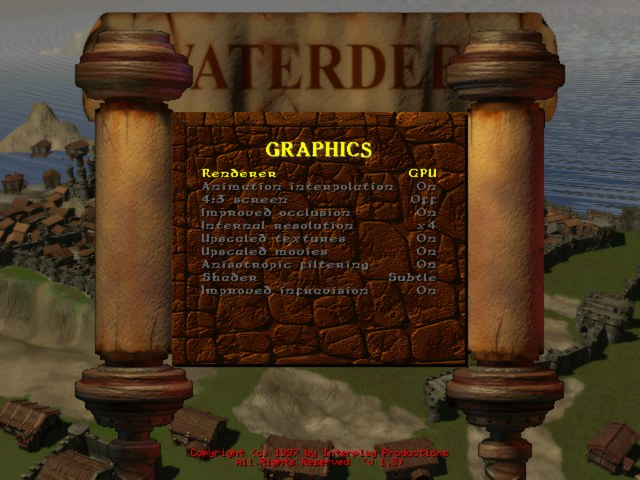
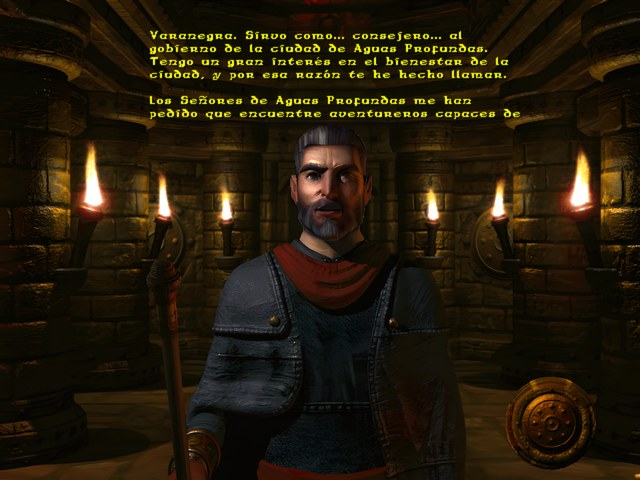

# ASCENT-DTU

ASCENT-DTU is a source port of Descent to Undermountain (Interplay, 1997).

The original game runs on DOS and uses a modified Descent engine. It had a troubled development, not helped by using an engine meant for spaceships flying mining tunnels instead of
dungeon crawling humanoids. Version 1.3 of the game still has many defects.

ASCENT-DTU aims to make the game playable on modern Windows and Linux, alongside bugfixes and optional improvements.
On Windows, run the setup program; on Linux, unpack the release tarball and run `./setup.sh` (see [docs/install.md](docs/install.md)).

  
  
  

## New features

* Gamepad support
* A new 32-bit color GPU based renderer allowing for higher resolutions, alongside a depth buffer (no more enemies clipping through walls!).
* Upscaled textures and movies.
* Content-id-safe streaming and gameplay recordings. Originally, the Yawning Portal uses "Return From The Hunt" as a theme. It's been replaced with the "Seedy Tavern" theme by Jeremy Soule, from Neverwinter Nights.
* Improved physics, untied to the framerate. No more floating corpses or cursed ladders. Jumping no longer pulls you back down in a microsecond.
* Animation interpolation.
* Target hint: the cursor turns a little red when your attack would reach an enemy.
* Full screen shaders.
* Optional ambient occlusion.
* Improved lighting: the lights of warps, rest places, spells and explosions change smoothly, not in steps.
* A Spanish translation! (More languages coming soon).

  
  
  

## Rules & game fixes

**Combat and armor**

* Bracers of Defense count as armor, so a Ring or Cloak of Protection works with them.
* Only the highest magic protection bonus counts: armor magic, a ring, a cloak or an amulet. Shields always add in full.
* Dexterity adds to the attack roll of arrows, bolts, thrown weapons and spells that need an attack roll (Magic Stone, Melf's Minute Meteors...).
* Thrown weapons add Strength to hit, as well as to damage, and no longer get the bonus of the bow or crossbow you wear.
* One hit roll per swing, whatever the frame rate.
* Bows and crossbows wait between shots, and the Short Bow of Speed and the Short Sword of Quickness really are twice as fast.
* Backstab works from behind the target, and only someone who can see you stops it.

**Spells and saving throws**

* Rings, cloaks and amulets of protection add to saving throws. The statistics screen shows the five saves.
* Dwarves and halflings get the Constitution bonus to saves against rods, staves, wands and spells. 
* Wisdom adjusts saves against mind-affecting spells.
* Magic Missile has no saving throw.
* Magical Stone and Melf's Minute Meteors use an attack roll instead of a saving throw.
* Melf's Acid Arrow uses an attack roll and keeps burning for a few rounds.
* Stone Skin no longer ends your other spells, and a cure no longer takes away the hit points of Aid. 
* Strength and Infravision no longer end at once when cast at a high level.
* Turn Undead no longer leaves an undead that can never be turned again.
* A character learns a spell only when its classes can cast it: a mage no longer learns Protection From Fire, a priest spell, from a scroll.
* Spells and potions keep their full time after nine hours of play; in 1.3 an effect that ends past that point ends at once (a Potion of Freedom showed "Free Action expired." right away).
* Any damage wakes a sleeping character, not only a melee hit. While asleep, the view is black with "zzz" and the character cannot move, look around or act.

**Items**

* The Potions of Hill Giant Strength and Invulnerability work only for fighters.
* Picking up more than a full stack leaves the rest on the floor instead of losing it, and endless stacks stay endless.
* The Scroll of the Illithids and the Ruldegost Document are one item each, not 18 and 21 copies.
* The market uses your Charisma, not that of the last character you created (a fun bug from the original).
* The rewards of Khelben add their goods to the market even before your first visit there; a saved game gets the goods of the rewards it missed.
* Scrolls you cannot learn, and spare copies of spells you know, can be sold at the market, as in the original.

**Quests and levels**

* The guildleader's cache in the thieves' guild opens.
* Devlin's reward for the goblins works, and scripted pauses in conversations can be skipped.
* Some cutting room floor items found throughout the original code; a few messages, mostly. Also, a *healing ladder*.
* The Shadow Thieves no longer attack you if you are a member of the guild.
* The lone mind flayer of the Drow Stronghold hides the Scroll of the Illithids and drops it when it dies.
* Traps run on real seconds instead of depending on the FPS, and they stop while the game is paused.
* Some triggers that never fired in seven levels work now.
* The message of a place does not show again until 30 seconds after you left it, so a fight in and out of a cell no longer repeats it, and the message of an event that is over (a trap that ran, creatures that came out) shows only while the event can happen.

**Creatures**

* Trolls need fire (or a very thorough hacking while down!) to die. Otherwise, they'll keep standing up to fight. The code was already partially in the game. Your spells hit a troll that is down: fire and acid (Fireball, Melf's Acid Arrow) end it for good.
* Creatures take fall damage, and long falls always hurt, whatever the frame rate.
* With Improved AI (the setting that was Improved pathfinding), creatures handle corners and ladders better, and they notice you only along an open way: a wall or a closed door hides you, and an alarm stops at a closed door. Humanoid creatures open unlocked doors, but only once they fight you. A closed door stops blows in both directions. Creatures that would attack after a talk join their friends when a fight starts in front of them.

**Controls**

* A separate Climb Wall key, so Activate no longer tries to climb a wall when you pull a lever.
* Walking into a lever, a button or a sign no longer works it (and no longer fills the log with its message): use Activate.

Each fix can be turned off with an `-orig` command line option to compare with version 1.3 (the AI changes with the Improved AI setting), and [docs/audit/defects-1.3.md](docs/audit/defects-1.3.md) has the full list.

## Game files

This repository does not contain game files.
You must own a copy of Descent to Undermountain to use this project.

## Downloads during installation

The installer and the content manager (`ascent-content`) can download the 1.3 patch, the optional upscaled textures and movies, the Spanish translation and the replacement music.
The server they download this content from uses Cloudflare.

Some internet providers block Cloudflare addresses at some times. For example, providers in Spain block them during football matches.
If a download stops with a timeout, try again later or use a VPN.
Then start "ASCENT-DTU Content" from the Start menu to download the files that are missing.

The upscaled files are not necessary to play. The 1.3 patch is also available at [The Patches Scrolls](https://www.patches-scrolls.de/patch/1215/7/41518/download).

## Troubleshooting

Each run writes a log in `%APPDATA%\ASCENT-DTU\logs` (on Linux `~/.local/share/ASCENT-DTU/logs`). If the game fails or crashes, send the newest `ascent-*.log` (and the `.dmp` file with the same name after a crash).
See [docs/debug_logs.md](docs/debug_logs.md).

## Source layout

- `engine/`: the Descent 1 source release (version 1.5) from Parallax Software. It is the base of the port.
- `tools/`: Python tools that read the original game files.
- `docs/formats/`: the file format documents.

See [docs/README.md](docs/README.md) for the documents and [CONTRIBUTING.md](CONTRIBUTING.md) to contribute.

## License

The code in `engine/` is the property of Parallax Software Corporation.
The Parallax license permits use and derivative works only for non-commercial purposes.
The full text is in `engine/readme.txt`. This project is non-commercial.

## Legal

Descent to Undermountain is a trademark of its owners.
This project has no connection with Interplay or with Wizards of the Coast.
